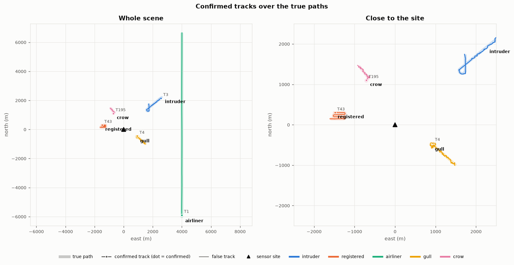
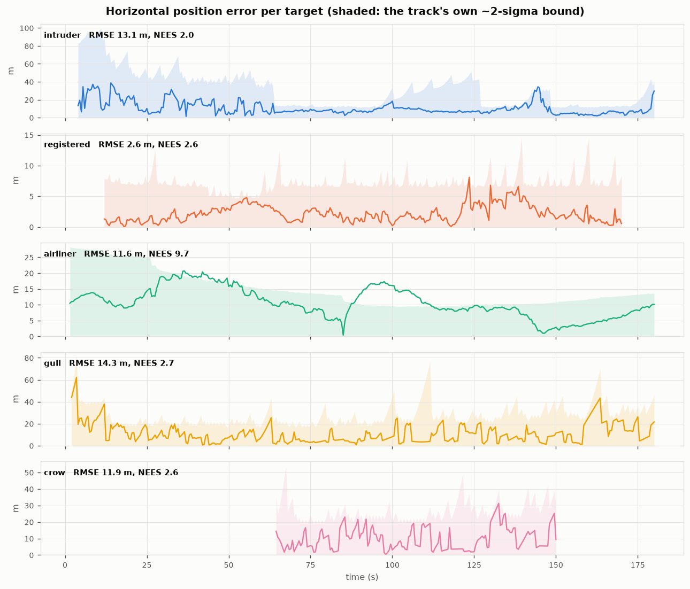
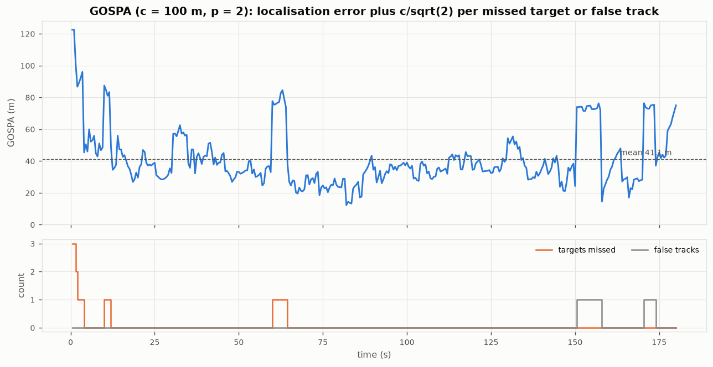
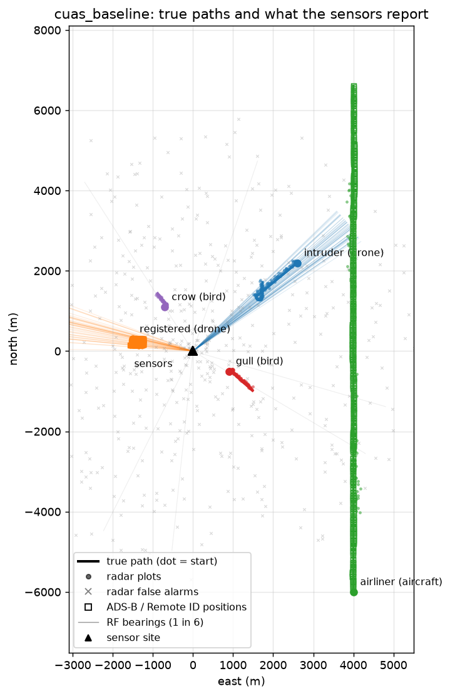

# skytrack

A multi-sensor target tracker for ground-based counter-drone (C-UAS) sites,
and the sensor simulator that tests it. C++20, no hardware needed.

The simulator flies drones, aircraft and birds past a site with a rotating
radar, two cameras (one on a pan-tilt head), an RF direction finder, ADS-B and
Remote ID receivers, and an online flight feed. The sensors are imperfect on
purpose. They miss targets, report false alarms, are mounted slightly wrong,
have clocks that are off, and deliver messages late, out of order or not at
all.

The tracker fuses all of it into one track per target:

- It learns each sensor's mounting and clock errors from the aircraft and
  drones that broadcast their own position.
- It keeps its covariance honest about errors that measurements share and
  cannot average away (a target's GNSS error, a sensor's mounting error).
- Several tracker nodes can feed a fusion centre that combines their tracks
  without double counting what they share (covariance intersection).
- The tracker's own output can point the pan-tilt camera (closed-loop
  cueing).

Everything is scored against the simulator's ground truth with GOSPA, track
continuity, covariance consistency (NEES) and time to classify.



**Baseline scene** (5 targets, 180 s, 8 random seeds):

- Targets are tracked 98.1% of the time.
- There are 3 track breaks across 40 target runs and no false tracks.
- Mean GOSPA is 42.5 m.
- Position NEES is 2.8 for drones and birds (3 is honest) and 6.9 for the
  airliner (see [Known limitations](#known-limitations)).

Every number in this README comes from one of the three benchmark scripts:
[`tools/benchmark.py`](tools/benchmark.py),
[`tools/two_sites.py`](tools/two_sites.py) and
[`tools/cueing.py`](tools/cueing.py). CI reruns them and fails if a result
gets worse than [`tools/thresholds.json`](tools/thresholds.json) allows.

## Quick start

```bash
cmake -S . -B build
cmake --build build -j
ctest --test-dir build

./build/skytrack_sim   scenarios/cuas_baseline.json runs/cuas_baseline   # simulate
./build/skytrack_track runs/cuas_baseline                                # track
./build/skytrack_eval  runs/cuas_baseline                                # score against truth
uv run tools/plot_tracks.py runs/cuas_baseline                           # plot

./build/skytrack_cue scenarios/cuas_baseline.json runs/cued              # camera pointed by the tracker
./build/skytrack_eval runs/cued

python3 tools/benchmark.py    # tracker: seeds, ablations, latency, clutter
python3 tools/two_sites.py    # two nodes and a fusion centre
python3 tools/cueing.py       # closed-loop camera cueing
```

Or in Docker (the image build compiles with `-Werror` and runs the tests):

```bash
docker build -t skytrack .
docker run --rm skytrack
```

Requirements:

- a C++20 compiler and CMake 3.25+
- Eigen 3.4+ and nlohmann/json 3.10+:
  - macOS: `brew install eigen nlohmann-json`
  - Ubuntu: `apt install libeigen3-dev nlohmann-json3-dev`
- network access at configure time, which CMake uses to download GoogleTest
- Python 3.10+ for the benchmark scripts (standard library only)
- [uv](https://docs.astral.sh/uv/) for the plot scripts, which installs numpy
  and matplotlib for them

What `skytrack_eval` prints for the baseline run (seed 42):

```text
target      class    tracked to_track  tracks  switches   gaps      rmse_h rmse_v   nees class
intruder    drone        98%     4.0s       1         0      0       13.1m  15.0m    2.0  100%
registered  drone        99%     2.0s       1         0      0        2.6m   4.9m    2.6  100%
airliner    aircraft     99%     1.1s       1         0      0       11.6m  11.9m    9.7  100%
gull        bird         99%     1.7s       1         0      0       14.3m  17.1m    2.7    0%
crow        bird         95%     2.6s       1         0      0       11.9m  14.5m    2.6    0%

GOSPA (c = 100 m): mean 41.1 m, localisation 17.6 m, 0.07 missed and 0.06 false tracks on average
confirmed tracks: 5, false: 0 (0.0 per hour)
detections used: 99.2% of target detections, 2.19% of false alarms; 0 went to the wrong target
```

The birds are classed `unknown` here because the scripted pan-tilt camera
never looks at them. Pointed by the tracker, it classifies both
([Camera cueing](#camera-cueing)).

## Results

"Breaks" counts track switches plus gaps, summed over all target runs. A
false track is a confirmed track that spent less than half its life on a
target. RMSE is horizontal. NEES is the mean position NEES of a target run:
3 means the covariance is honest, more means the tracker is overconfident.
Each NEES cell gives the mean over runs of that class, with the worst run in
brackets.

### Tracker

Baseline scene, 8 seeds x 5 targets x 180 s:

| configuration | mean GOSPA | tracked | time to track | breaks | false tracks | RMSE drones | RMSE birds | NEES drones | NEES birds | NEES airliner |
|---|---|---|---|---|---|---|---|---|---|---|
| `default` (2-of-3 confirmation, every feature on) | 42.5 m | 98.1% | 2.2 s | 3 | 0 | 9.6 m | 14.6 m | 2.8 (max 5.2) | 2.8 (max 3.9) | 6.9 (max 9.7) |
| `strict` (3-of-4 confirmation) | 44.0 m | 96.6% | 4.0 s | 4 | 0 | 9.6 m | 14.2 m | 2.8 (max 5.2) | 2.8 (max 3.9) | 6.9 (max 9.7) |
| `no_notch` (no Doppler-notch inference) | 47.2 m | 97.1% | 2.2 s | 11 | 0 | 11.7 m | 14.6 m | 2.8 (max 5.1) | 2.8 (max 3.9) | 6.9 (max 9.7) |
| `no_registration` (no online sensor registration) | 51.5 m | 98.0% | 2.2 s | 6 | 0 | 12.1 m | 27.5 m | 1.7 (max 2.8) | 2.2 (max 2.8) | 2.8 (max 3.6) |
| `white_registration` (remaining registration error as white noise) | 39.8 m | 98.1% | 2.2 s | 1 | 1 | 7.8 m | 14.5 m | 7.1 (max 29.1) | 2.9 (max 4.1) | 38.2 (max 64.3) |

Reorder window and late initiation, same scene and seeds:

| setting | mean GOSPA | report age p50 | time to track | worst time to track | breaks |
|---|---|---|---|---|---|
| 0.3 s window | 43.7 m | 0.40 s | 2.2 s | 7.1 s | 6 |
| **0.6 s window (default)** | 42.5 m | 0.66 s | 2.2 s | 7.1 s | 3 |
| 1.3 s window | 44.8 m | 1.37 s | 2.2 s | 7.1 s | 4 |
| 0.3 s window, no late initiation | 100.4 m | 0.39 s | 5.2 s | 65.2 s | 1 |
| 0.6 s window, no late initiation | 79.3 m | 0.66 s | 10.3 s | 132.2 s | 1 |

Report age is how old a track report is when it is published: the host clock
at publication minus the report's time. That is the delay a display or an
effector sees.

Clutter only (the same site and sensors, no targets), 8 seeds x 180 s:

| configuration | confirmed false tracks | per hour | longest lived |
|---|---|---|---|
| `default` | 2 | 5.0 | 5.5 s |
| `strict` | 0 | 0.0 | - |

What the rows show:

- **Honest covariance costs a little accuracy.** `white_registration` treats
  each sensor's remaining mounting error as fresh noise on every
  measurement. It gets 3 m better GOSPA, but its NEES reaches 29 on a drone
  and 64 on the airliner. A mounting error is the same on every frame, so
  averaging frames does not remove it. Treating it as white noise lets the
  filter believe it does.
  The default keeps that error as a "consider" parameter (see
  [Correlated errors](#correlated-errors)). The filter then knows what it
  cannot average away: it gives up 3 m of accuracy and keeps its NEES near
  3 for drones and birds.
- **Notch inference** removes most of the track breaks (11 down to 3). A
  hovering drone is invisible to a Doppler radar. Without notch inference the
  tracker keeps flying the track away at the old speed until it is lost.
- **Online registration** halves the error on birds. Birds are seen only by
  radar and the RF direction finder, so the radar's 1° heading error goes
  straight into their position (about 40 m at 2.5 km). Without registration
  the tracker is honest (NEES under 3) but much less accurate.
- **Latency is a trade-off with a cliff.** The reorder window is how long the
  tracker holds data back to process it in time order. It sets the report
  age almost one-for-one: 0.6 s gives 0.66 s.
  Shortening the window is only safe because of **late initiation**: a
  measurement that arrives after its window closed may still start a track
  if it is under 3 s late. Without it, a rotating radar's scan (which
  arrives after the sweep) is mostly too late to start anything, and one
  target took 132 s to get a track.
  The 1.3 s window is no more accurate than 0.6 s: everything later is
  already used as an out-of-sequence update.
- **Confirmation logic** is a trade-off. 2-of-3 confirms 2 s sooner than
  3-of-4. 3-of-4 never confirmed a false track in clutter, but loses more of
  the short-lived crow. `configs/strict.json` is the 3-of-4 setting.

### Distributed tracking

[`scenarios/two_sites.json`](scenarios/two_sites.json) is the baseline scene
watched by two sensor nodes 3.2 km apart:

- **Site A** has the baseline sensors.
- **Site B** has a second rotating radar, a camera, an RF direction finder
  and its own ADS-B receiver.
- Both take the same online flight feed.

Each node runs its own tracker on its own sensors
([`configs/nodes/two_sites.json`](configs/nodes/two_sites.json)) and sends
its confirmed tracks to a fusion centre. 8 seeds:

| | GOSPA | breaks | false tracks | NEES intruder | NEES airliner | NEES gull |
|---|---|---|---|---|---|---|
| site A alone | 42.5 m | 3 | 0 | 3.0 (max 5.2) | 6.9 (max 9.7) | 2.6 (max 3.1) |
| site B alone | 123.2 m | 78 | 6 | 3.2 (max 4.3) | 3.5 (max 4.7) | 2.8 (max 4.1) |
| **fused, covariance intersection** | 41.1 m | 3 | 2 | 2.4 (max 4.8) | 6.6 (max 8.8) | 2.4 (max 3.0) |
| fused, information sum (assumes independence) | 41.1 m | 3 | 2 | 3.4 (max 5.8) | 9.4 (max 11.5) | 2.6 (max 3.1) |
| fused, best single node | 45.1 m | 15 | 2 | 2.9 (max 5.2) | 7.1 (max 9.4) | 2.7 (max 3.2) |
| central tracker on every measurement | 39.5 m | 1 | 2 | 2.8 (max 5.5) | 7.7 (max 10.5) | 2.3 (max 2.8) |

With site A's radar sending nothing from 60 s to 120 s:

| | GOSPA | breaks | false tracks | NEES intruder | NEES airliner |
|---|---|---|---|---|---|
| site A alone | 81.9 m | 45 | 5 | 4.2 (max 7.5) | 6.8 (max 9.4) |
| **fused, covariance intersection** | 72.6 m | 45 | 8 | 2.9 (max 6.1) | 6.2 (max 8.1) |
| fused, information sum | 73.1 m | 45 | 8 | 4.2 (max 7.9) | 9.4 (max 11.9) |
| central tracker | 62.6 m | 26 | 1 | 2.7 (max 4.7) | 7.8 (max 10.9) |

What crosses the network, per node:

| | site A | site B |
|---|---|---|
| confirmed tracks, state + full covariance | 3.7 kB/s | 2.4 kB/s |
| raw measurements | 10.5 kB/s | 4.5 kB/s |

What the rows show:

- **Fusion beats either node alone, and stays honest.** Site B on its own is
  poor. Seen from 3 km away, the targets near site A sit in a narrow sector
  of bearings, so its direction finder and camera confuse them.
  Fused with covariance intersection, the picture is still better than site
  A's (41.1 m against 42.5 m). When site A's radar fails, it is much better
  (72.6 m against 81.9 m).
- **The information sum double counts.** The two nodes' errors are
  correlated: they saw the same manoeuvres, and both used the online flight
  feed. The information sum assumes they are independent. It gets the same
  GOSPA but is overconfident: intruder NEES 3.4 against 2.4, airliner 9.4
  against 6.6. Covariance intersection is consistent whatever the
  correlation is.
- **Track-level fusion is not measurement-level fusion.** A central tracker
  on every raw measurement does better still, most visibly during the radar
  outage (62.6 m). It can combine site B's radar with site A's cameras on
  one target, and the nodes' tracks cannot. In exchange, the nodes send 40%
  as many bytes, need no shared sensor models and keep working on their own
  if the link fails.
- **A centre needs track management of its own.** At first, plain fusion of
  these two nodes was worse than site A alone (GOSPA 50 m, 13 false tracks):
  every bad site B track turned into a global track.
  Three rules fixed it; they are listed under
  [How the fusion centre works](#how-the-fusion-centre-works).

### Camera cueing

The baseline scene with three ways to use the narrow-field pan-tilt camera.
"Time to class" is the median over seeds, from the first detection to the
first report with the right class. 8 seeds:

| pan-tilt camera | GOSPA | breaks | intruder: time to class | gull: time to class | crow: time to class | gull: right class | crow: right class |
|---|---|---|---|---|---|---|---|
| none | 62.6 m | 28 | 4.0 s (8/8) | never (0/8) | never (0/8) | 0% | 0% |
| scripted pan/tilt schedule | 42.5 m | 3 | 4.0 s (8/8) | never (0/8) | never (0/8) | 0% | 0% |
| **cued by the tracker** | 44.7 m | 9 | 4.0 s (8/8) | 5.4 s (8/8) | 6.3 s (8/8) | 96% | 94% |

- The scripted schedule was written by hand knowing where the targets would
  be: an operator with perfect foresight. The cued camera knows only what the
  tracker publishes, 0.66 s late. Its GOSPA is 2.2 m worse than the
  script's, and it is the only one that gets the birds classified. The birds
  are too small for the wide camera, and no other sensor reports a class.
- The intruder is classified by its RF control-link signature 4 s after it
  is first seen, before any camera looks at it.
- The cued camera is on a track it chose 86% of the time; the rest is
  slewing.

Per-target error over time, with the track's own uncertainty:



GOSPA over time. The spikes at 150 s and 170 s are tracks still coasting
after their target left the scene; they are deleted 8 s later.



## How the tracker works

```text
measurements.jsonl ──► convert to tracker time ──► reorder buffer ──► per event, in time order:
  (arrival order)       apply registration          (0.6 s window)     predict, gate, assign (GNN),
                                                                        update (EKF + consider terms),
                                                                        start, confirm, use radar misses,
                                                                        learn registration, delete, merge
                                                     ──► tracks.csv at 2 Hz
```

### Time

- Each detection is placed on the tracker's clock: its sensor timestamp minus
  the known (or learned) clock offset. Sensors without timestamps use arrival
  time minus an assumed latency.
- A reorder buffer holds messages for 0.6 s and releases events in time order.
  A rotating radar's scan arrives in one message after the sweep. It is split
  into 0.1 s sectors so each part is processed close to when it was measured.
- **Out-of-sequence measurements** are used, not dropped. A measurement older
  than the window (the online flight feed arrives about 6 s late) is compared
  with the track predicted back to its time, and the process noise over that
  gap is added to its noise. Registration corrections are applied when a
  measurement is processed, not when it arrived, so a late measurement gets
  the best estimate available.
- **Late initiation.** A measurement released after its window may still
  start a track if it is less than 3 s late. Older ones only update tracks.
- Arrival order within the window does not change the output (tested
  bit-for-bit). With online registration it changes only which correction a
  message gets: a live system can only use what it has learned so far.

### Filter and sensor models

- Extended Kalman filter in local east-north-up coordinates, state
  `[e, n, u, ve, vn, vu]`. The motion model is nearly-constant velocity
  with separate horizontal and vertical process noise. The covariance update
  uses the Joseph form.
- Each sensor is a measurement function `h(x)` plus its noise
  ([`sensor_model.hpp`](include/skytrack/tracking/sensor_model.hpp)):
  - radar: range, azimuth, elevation, range rate
  - camera: pixel coordinates through the pan-tilt head, pinhole model and
    lens distortion
  - RF direction finder: bearing only
  - ADS-B / Remote ID: WGS84 position and velocity converted to ENU, with the
    accuracy the report itself states (NACp-style) when it has one
- Jacobians are numerical, so a new sensor needs only `h(x)`.
- A test checks that every `h(x)` reproduces the simulator's noise-free
  output to 1e-6, so the tracker and simulator agree on every frame and
  angle convention.
- **Safeguards.** An innovation whose covariance is not positive definite is
  skipped and counted. A covariance with eigenvalues below 1e-4 m² is
  repaired and counted. Both counters are in `summary.json`.
  - Across the 168 tracker runs of the benchmarks, 136 of 463,000 updates
    were skipped (at most 7 in one run).
  - No covariance needed repair.

### Correlated errors

Two errors do not shrink when measurements are averaged, and the tracker
does not pretend they do:

- **A cooperative target's GNSS error.** Every ADS-B or Remote ID report from
  one aircraft carries the same slowly drifting position error. Each report
  is split into white noise (1 m) and that shared error (the stated accuracy).
  The shared error is modelled as first-order Gauss-Markov with a 30 s time
  constant.
- **A sensor's remaining registration error.** What online registration has
  not yet learned about a sensor's mounting and clock errors is the same on
  every frame.

Both are **consider parameters** (a Schmidt-Kalman filter). The filter does
not estimate them. For each track and each parameter, it keeps the
cross-covariance between the track's error and that parameter. Each update
then accounts for the part of the error that the next measurement will share:

- the innovation covariance includes it
- the gain is reduced by it
- the cross-covariance is carried through every prediction and update

Without this, the airliner's NEES was 38 (see the `white_registration` row).
Two tracks fed by the same sensor share that sensor's error. When deciding
whether two tracks are duplicates, the tracker subtracts that shared part
from the covariance of their difference.

### Association and track management

- **Global nearest neighbour.** The cost is the normalised distance, and
  "leave unassigned" is an explicit option for every measurement. The
  assignment is solved optimally (Hungarian, checked against brute force in
  the tests). Gates are chi-square at 99.9%.
- **Two stages.** Confirmed tracks choose first, so a new tentative track
  with a wide gate cannot steal an established track's measurement.
- **Identity.** A broadcast whose ADS-B or Remote ID identity differs from a
  track's can never update it. One with the same identity gets a wider gate.
- **Confirmation.**
  - Radar tracks: M of N radar scans that should have seen the track.
  - Cooperative tracks: two broadcasts.
- **Deletion.** After 3 s (tentative) or 8 s (confirmed) without an update,
  or when the position uncertainty grows past 500 m.
- **Clean-up.**
  - Duplicate confirmed tracks are merged, for example one started by radar
    and one by ADS-B.
    - The two estimates are fused by covariance intersection: their
      cross-correlation is unknown, and this is consistent whatever it is.
    - The merged track keeps what either knew about the radars (latest hit,
      RCS samples, misses).
  - A track with no radar support for 6 s is removed when it sits on the
    same line of sight (within 1.5°) as a radar-supported track. These are
    ghosts that bearing-only sensors keep alive.

### Using what the radar did not see

- **Expected detections.** After every sweep the tracker computes how likely
  the radar was to detect each track. That depends on range and on the
  target's radar cross section (RCS), estimated from detection SNRs. The SNR
  of reported detections is biased high, because only echoes above the
  threshold are reported; the estimator corrects for that (it is tested to be
  unbiased). The likelihood also includes the chance that the target's range
  rate falls inside the Doppler notch.
- **Notch inference.** Suppose the radar keeps missing a track it should see,
  while cameras or the direction finder still update it. If those misses would
  be very unlikely for a moving target (below 1e-3), the target is taken to be
  hovering. The tracker applies a range-rate ≈ 0 pseudo-measurement, which
  stops the track from flying off.
  The pseudo-measurement must itself pass a consistency gate (chi-square,
  1 degree of freedom, 99%). If the track's own velocity says the target is
  clearly moving, the misses have another cause and no hover is inferred.
- **Refutation.** If the misses cannot be explained that way and are below
  1e-4, the track is deleted: nothing is there.

### Online sensor registration

[`registration.hpp`](include/skytrack/tracking/registration.hpp)

- **Model.** Each sensor's heading error, pitch error and clock offset form
  a small Kalman filter. Its prior is the survey accuracy (1°) and the timing
  accuracy (0.25 s).
- **Evidence.** When a sensor detects an aircraft or drone that broadcasts its
  own GNSS position, the gap between the report and the broadcast is
  evidence about that sensor's errors.
  - The broadcast's own GNSS error is shared by every sample from that
    target. Registration keeps it as a consider parameter too, so many
    samples of one target do not look like independent evidence.
  - Its correlation fades with a 30 s time constant.
- **Correction.** Each measurement is corrected with the current estimate,
  when it is processed.
- **Remaining uncertainty.** What is still unknown goes into the tracks as a
  consider parameter (see [Correlated errors](#correlated-errors)). If it
  were ignored altogether, the mispointed zoom camera's 0.003° noise claim
  would push NEES above 1000.

Seed 42, estimated against injected:

| sensor | error | injected | estimated (±1σ) |
|---|---|---|---|
| radar-1 | heading | 1.00° | 1.04 ± 0.07° |
| cam-wide | heading | 0.30° | 0.51 ± 0.16° |
| cam-wide | clock | 0.08 s | 0.29 ± 0.19 s |
| rf-df-1 | heading | −2.00° | −1.60 ± 0.20° |
| cam-ptz | pitch | 0.20° | 0.32 ± 0.71° |

All are within 2σ. The pan-tilt camera's pitch stays near its prior
uncertainty, and that is correct. On the scripted schedule the camera only
looked at a cooperative target with the head panned about 80° to the side.
There, a mount pitch error turns into a roll of the image around a target
held at the centre, which cannot be seen.

### Classification

Each track keeps votes:

- camera labels, weighted by confidence
- recognised RF control-link signatures, which point to a drone
- a broadcast identity: ADS-B means aircraft, Remote ID means drone

## How the fusion centre works

[`track_fusion.hpp`](include/skytrack/fusion/track_fusion.hpp),
[`skytrack_fuse`](apps/skytrack_fuse.cpp)

```text
node A: skytrack_track --sensors ... ──► tracks.csv (state + full covariance, 2 Hz) ─┐
node B: skytrack_track --sensors ... ──► tracks.csv ─────────────────────────────────┴─► skytrack_fuse ──► fused tracks.csv
```

- **What crosses the network.** Each node sends its confirmed tracks: the
  state and the full 6x6 covariance (position-velocity cross terms included)
  at each output time. Each node has its own track IDs.
- **Persistent association.** The centre keeps a map from (node, local track
  ID) to a global track ID. Once associated, a node track stays with its
  global track. A global track keeps its ID while any node still follows the
  target, even across a break in one node's track (tested).
- **New node tracks.** A node track not yet associated may join a global
  track that has no track from that node yet. The choice is global nearest
  neighbour with a chi-square gate (6 degrees of freedom, 99%).
  - Matching ADS-B or Remote ID identities always associate.
  - Conflicting identities never do.
  - What is left starts a new global track.
  - Two global tracks with no node in common that come to agree are merged.
- **Combining.**
  - The configured rule (covariance intersection, information sum or best
    node) only fuses.
  - Association always gates on the covariance-intersection estimate, so the
    three rules see the same associations.
- **Rules that fix the weak node.** Without them, plain fusion of the two
  nodes was worse than site A alone:
  1. A node track vaguer than 50 m (1σ, horizontal) may not start a global
     track. A bearing-only track at an unknown range is not a target to
     report. It may still join one.
  2. A node track that disagrees with its global track's longest-held member
     is left out of the fused estimate at once. After 3 output times beyond
     chi-square 99.99% it is split off.
  3. A split-off track is presumed corrupted, because the longer-held track
     wins. It is not published on its own until another node backs it.

## Camera cueing

[`cueing.hpp`](include/skytrack/cueing/cueing.hpp),
[`skytrack_cue`](apps/skytrack_cue.cpp)

- **Co-simulation.** The other sensors are simulated as usual. The pan-tilt
  camera is simulated frame by frame (15 Hz). Before each frame, the tracker
  ingests everything that has arrived by then. The controller then reads the
  tracker's latest published picture, which is about 0.66 s old, and moves the
  gimbal. The frame is rendered where the gimbal actually points, and goes
  back to the tracker with the camera's network latency.
- **Gimbal.** Rate-limited to 60°/s in pan and tilt. The controller knows
  only the camera's nominal mount, as the tracker does. A test checks that
  pointing at a point puts it at the exact image centre of the camera model.
- **Priority policy.** Tracks with an ADS-B or Remote ID identity already say
  what they are and are skipped. Of the rest, in order:
  1. no class yet and never looked at, the most urgent first
  2. no class yet, last looked at over 10 s ago
  3. classified as anything but a drone, not looked at for 30 s (a check)
  4. custody: with nothing else to do, stay on the most urgent drone. That
     gives the tracker precise bearings on the threat.

  Urgency is the time the target would need to reach the site at its
  current closing speed, plus the time to slew to it.
- **Dwell.** The camera stays at least 1.5 s on a track, and at most 6 s if
  the track is still unclassified. It gives up on a track it cannot reach in
  4 s. The choice is revisited after each dwell, so a new track pre-empts
  custody.
- The first version had no custody rule. It classified the birds but
  wandered off the intruder, and on seed 42 GOSPA was 10 m worse than the
  script's. Custody closed most of that gap.

## Evaluation

[`metrics.hpp`](include/skytrack/eval/metrics.hpp) scores confirmed tracks at
every output time:

- **GOSPA** (α = 2, p = 2, c = 100 m) with an optimal assignment. Its parts
  are the localisation error, missed targets and false tracks.
- **Per target:**
  - fraction of time tracked, and time to first track after first detection
  - time to the right class after first detection
  - track IDs that followed it, switches and gaps
  - horizontal, vertical and velocity RMSE
  - position NEES (and the fraction inside the 95% bound)
  - fraction of time with the right class
- **Per track:** time on target; false if under half.
- **Association:** the share of target detections and false alarms that
  updated a confirmed track, and updates that went to the wrong target.
  This uses the simulator's record of each detection's origin.
- **Latency:** the age of each confirmed report when published (p50, p95,
  p99), and wall-clock processing time per message.

## Known limitations

- **The airliner is mildly overconfident** (NEES 6.9, worst 9.7, against 3).
  Its GNSS error and the sensors' registration errors are each modelled
  as consider parameters, but the correlation between them is not. Registration
  learns from the airliner's own broadcasts, so the two are correlated.
  Modelling that coupling made the filter unstable here, so it was left out.
- **Honest covariance costs about 3 m of GOSPA** against treating
  registration error as white noise (see the `white_registration` row).
  This is deliberate: an overconfident tracker gates out good measurements
  and misleads a fusion centre downstream.
- **One motion model.** Nearly-constant velocity lags in hard turns: the
  gull circles at 20–25°/s, the crow at up to 30°/s. An IMM would follow
  both straight and turning flight.
- **Single hypothesis.** GNN commits to one assignment per scan. Crossing
  targets in dense clutter would need JPDA or MHT.
- **The fusion centre has no coverage model.** It cannot tell a weak node's
  lone false track from a real target that only that node sees. Its rules
  remove most such tracks (2 false tracks in 8 runs, against site B's 6).
  The principled fix is negative information: each node publishes its
  coverage, and a track one node reports where another should see it but
  does not loses existence probability.
- **The cueing policy is a priority list**, not a sensor-management
  optimiser. It does not weigh expected information gain, or several
  cameras at once.
- **Registration needs cooperative targets in view.** It does not estimate
  position offsets or roll.
- **Simulated data only.** Detection, clutter and error models are standard
  textbook ones. They have not been fitted to a real sensor.

## Tests and CI

There are 83 GoogleTest cases. Besides unit tests of geodesy, random
streams, trajectories and each simulated sensor, they cover:

- every sensor model `h(x)` against the noise-free simulator
- the assignment solver against brute force on 300 random problems, and
  GOSPA against hand-computed values
- an unbiased RCS estimate from thresholded SNRs
- covariance intersection: consistent for any cross-correlation, on random
  covariances
- strict config parsing, and `configs/default.json` matching the built-in
  defaults
- corrupt input: bad measurement lines are skipped and counted, and
  `tracks.csv` round-trips the full covariance
- end to end, on the tracker:
  - one honest track on a single drone
  - one track per target on the baseline, across 5 seeds, with NEES bounds
    per class
  - registration estimates within 3σ of the injected errors
  - broadcasts not averaging away their shared GNSS error, and registration
    error not averaged away across frames
  - notch inference holding a hovering drone, and its gate rejecting a
    false hover
  - radar scans that arrive after the reorder window still used; a short
    window still starting tracks promptly
  - refuting a track no sensor sees, but not one another sensor still sees
  - two tracks on one target merged by covariance intersection
  - reorder invariance
  - false tracks in clutter-only scenes rare and short-lived
- end to end, fusion and cueing:
  - the information sum overconfident and covariance intersection honest
    when nodes share errors
  - global IDs kept across a node's track break, identities deciding
    association, and split-off tracks withheld until corroborated
  - the two-site scene: fused at least as good as the better node, and more
    honest than the information sum
  - the gimbal's slew limit, the priority policy, and closed-loop cueing
    classifying the birds

CI ([`.github/workflows/ci.yml`](.github/workflows/ci.yml)):

- builds with `-Werror`, AddressSanitizer and UndefinedBehaviorSanitizer
- runs the tests
- simulates, tracks and scores every scenario. It also runs two nodes and
  the fusion centre, and the cued camera
- runs the three benchmarks in a release build, posts their tables to the job
  summary, and fails on a regression against
  [`tools/thresholds.json`](tools/thresholds.json)
- builds the Docker image, which runs the tests inside, and runs its demo

## The simulator

### Targets

Each target follows a chain of motion segments, solved exactly at any time:

- `cv`: constant velocity
- `ca`: constant acceleration
- `ct`: coordinated turn

A target has:

- a radar cross section, which the radar uses
- a visible size, which the cameras use
- optionally an RF signature: the control link it emits, which the direction finder hears
- optionally a cooperative broadcast (ADS-B or Remote ID) carrying its own GNSS
  position. That position has a slowly varying error, and every receiver of
  that broadcast sees the same error. The report states its accuracy, as
  ADS-B's NACp does.

### Sensors

| Type | Reports | Notable behaviour |
|---|---|---|
| `radar` | range, azimuth, elevation, range rate, SNR | Swerling I detection (Pd falls with range^4). Staring or rotating; a rotating radar measures each target when its beam passes, and sends the scan when the sweep ends. A Doppler notch hides hovering targets. Clutter false alarms. |
| `camera` | box centre and size in pixels, class label, confidence | Pinhole model with radial distortion. Detection probability grows with apparent size. Optional pan-tilt head, on a schedule or pointed in closed loop; its pointing is reported with every frame. Class labels are sometimes wrong. |
| `rf_bearing` | bearing, SNR, emitter type | Hears only targets that emit. Bearing only: no range, no elevation. |
| `cooperative` | WGS84 position, velocity, identity and stated accuracy | ADS-B or Remote ID receiver. An online feed (OpenSky-style) is the same thing with seconds of delay and a slow update rate. |

### Errors you can inject per sensor

| Field | Effect |
|---|---|
| `position_offset_enu_m` | the sensor is not where the survey says |
| `heading_bias_deg`, `pitch_bias_deg`, `roll_bias_deg` | the sensor is turned slightly |
| `clock_offset_s`, `clock_drift_ppm` | its timestamps are wrong |
| `latency_mean_s`, `latency_jitter_s` | its messages arrive late |
| `dropout_prob` | whole messages are lost (visible as gaps in `seq`) |
| `noise_scale` | real noise differs from the data sheet value |
| `"timestamps": "arrival"` | the sensor sends no timestamps at all |

`skytrack_sim --seed N` reruns a scenario with different noise.
`--duration S` shortens or lengthens it.



## Files

Simulator output (`skytrack_sim <scenario> <run-dir>`, and `skytrack_cue`):

| File | Contents | Tracker may read it? |
|---|---|---|
| `measurements.jsonl` | one message per line, in arrival order | yes |
| `sensors.json` | sensor setup as configured, without the errors | yes |
| `scenario.json` | the scenario as run, seed included | no |
| `summary.json` | counts per sensor and per target | no |
| `truth/targets.csv` | target states at `truth_rate_hz` | no |
| `truth/measurement_origins.csv` | which target (or false alarm, `-1`) each detection came from | no |
| `truth/messages.csv` | true scan time and arrival time of each message | no |
| `truth/sensor_errors.json` | the injected errors | no |

Tracker output (`skytrack_track <run-dir> [--config FILE] [--sensors ID,...]
[--out DIR]`, default `<run-dir>/tracker/`):

| File | Contents |
|---|---|
| `tracks.csv` | every track at every output time: status, class, identity, emitter, ENU state, full covariance (upper triangle), sensors that updated it recently, when it was published |
| `associations.csv` | what happened to every measurement: updated or started which track, unused, or too old |
| `summary.json` | counters (safeguards included), the configuration used, registration estimates, sensor health, report latency |
| `timing.json` | wall-clock processing time per message (not deterministic, so kept apart) |
| `eval/` | written by `skytrack_eval`: `metrics.json`, `gospa.csv`, `matches.csv` |
| `plots/` | written by `tools/plot_tracks.py` |

`skytrack_fuse <node-dir>... --out DIR [--combine ci|independent|best]`
writes `tracks.csv` and `summary.json` in the same format. `skytrack_eval`
scores them like a tracker's. `skytrack_cue` writes `cueing.json` (frames on
target, looks) next to the tracker output.

Configurations live in [`configs/`](configs). `default.json` lists every
setting with its default value. `strict.json` and `ablations/` override a
few of them. `nodes/` says which sensors each node of a multi-site scenario
owns. Config files are strict: a misspelled field is an error, not a silent
default. The same holds for scenario files.

## Conventions

- **World frame:** east-north-up (ENU), in metres, anchored at the scenario `origin`.
- **Sensor body frame:** x along the boresight, y left, z up. Azimuths in a
  body frame are counter-clockwise, so a target to the right is negative.
- **Mount headings:** compass bearings (0 = north, clockwise), because that is
  how sensors are surveyed. Gimbal pan is clockwise too, tilt is up.
- **Angles:** degrees in scenario files, radians in measurements (field
  suffixes say which).
- **Times:**
  - `t_sensor_s` is the sensor's own clock.
  - `t_arrival_s` is when the fusion host received the message.
  - True times exist only under `truth/`.
- **Determinism:** the same build and seed give byte-identical output.
  - Each sensor draws from its own random streams: one for detections, one
    for network effects.
  - So changing one sensor never changes another, and changing only latency
    never changes detections.
  - The random distributions are implemented in the code itself rather than
    taken from the C++ standard library, because those differ between
    compilers (libc++ vs libstdc++).
  - Builds at other optimisation levels, or on other platforms, give the
    same detections. A handful of values can differ in their last digit
    (Eigen's vectorised maths rounds differently at different optimisation
    levels).

## Layout

```text
include/skytrack/            simulator: geodesy, targets, sensors, scenario files
include/skytrack/tracking/   tracker: sensor models, EKF with consider terms, assignment, registration,
                             track management, covariance intersection
include/skytrack/fusion/     track-to-track fusion centre
include/skytrack/cueing/     closed-loop camera cueing and its co-simulation
include/skytrack/eval/       scoring against ground truth (the tracker never links it)
src/, apps/                  implementation and the five command-line tools
tests/                       GoogleTest suite
scenarios/                   cuas_baseline.json, two_sites.json, single_drone.json
configs/                     tracker configurations, ablations, node assignments
tools/                       benchmark.py, two_sites.py, cueing.py, thresholds.json, plot scripts
```

## Roadmap

- [x] Simulator: targets, four sensor types, error injection, ground truth, plots
- [x] Tracker core: EKF in ENU, gating, global nearest neighbour, M-of-N track management
- [x] Out-of-sequence measurements, rotating-radar sectors, reorder buffer, late initiation
- [x] Radar negative information: RCS estimation, Doppler-notch inference (gated), track refutation
- [x] Online estimation of sensor mount and clock errors from cooperative targets
- [x] Shared errors as consider parameters: broadcast GNSS error, remaining registration error
- [x] Metrics: GOSPA, continuity, ID switches, false tracks per hour, NEES, time to classify, report age
- [x] Track-to-track fusion between sensor nodes (covariance intersection)
- [x] Closed-loop cueing of the pan-tilt camera from the tracker's output
- [x] Docker image; CI that fails on a benchmark regression
- [ ] IMM (constant velocity + coordinated turn), then JPDA
- [ ] Coverage-aware existence at the fusion centre (negative information across nodes)
- [ ] Real data: replay of recorded ADS-B (OpenSky), MMAUD
- [ ] ROS 2 wrapper and MCAP logging
